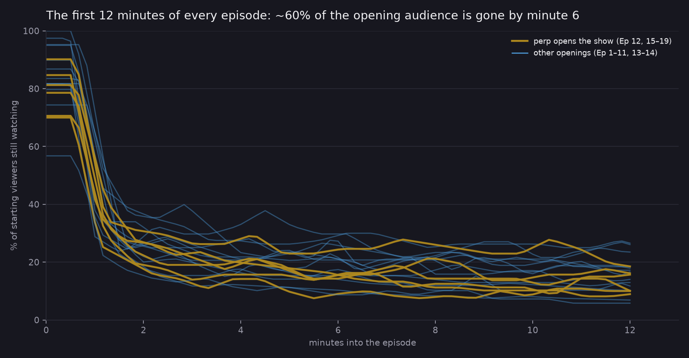
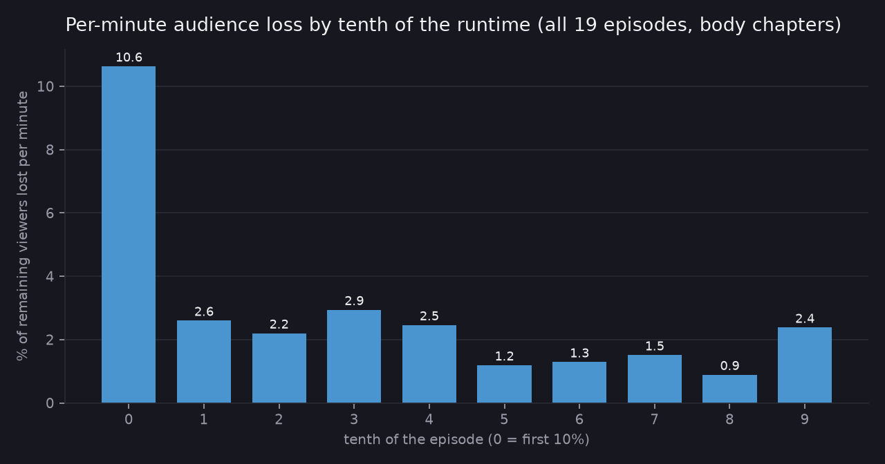
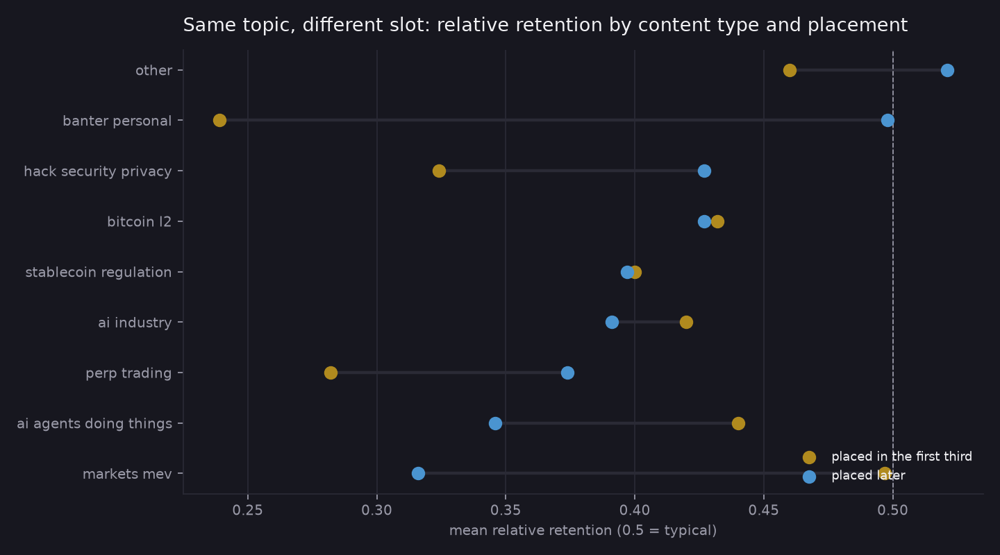
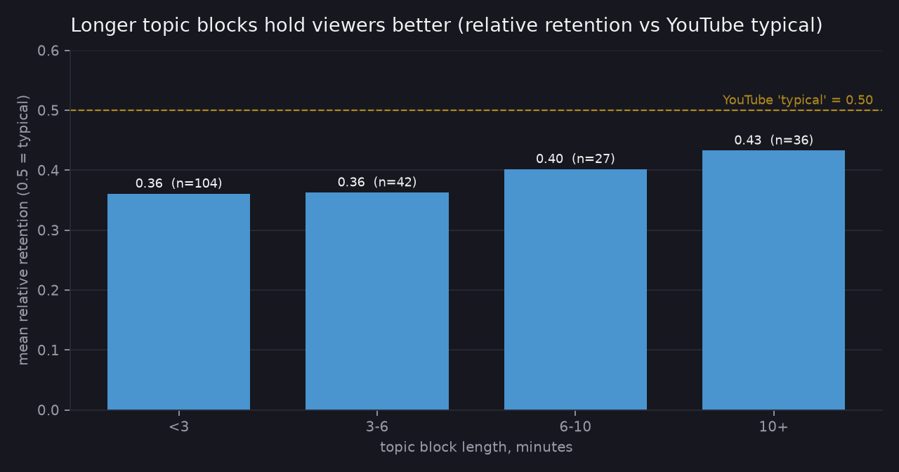

# Cross-episode retention study — Eps 1–19 (run 2026-10-20)

Every chapter of every episode as one row: 382 chapters, 304 body chapters, 220 with
speaker attribution (14 episodes have a speaker-labelled final-cut SRT; Eps 1–3, 7, 12,
17 do not). Retention curve per episode from `channel-data.json`, chapters from each
`segment-times.md`, text + speaker + pace from the SRT. Reproduce:

```
analytics/.venv/bin/python .claude/skills/channel-analytics/scripts/episode_study.py \
    analytics/channel-data.json episodes analytics/study --daily analytics/episode-daily.json
analytics/.venv/bin/python .claude/skills/channel-analytics/scripts/study_charts.py \
    analytics/channel-data.json analytics/study
```

Two measures per chapter. **hazard** = per-minute loss of the remaining audience
(raw, position-confounded). **vs_typ** = YouTube's relative-retention-performance
averaged over the chapter (position-normalised; 0.50 = typical for videos this length).
Group means are weighted by chapter minutes; CIs are 90% bootstrap.

## 1. The episode is decided in its first six minutes





| tenth of runtime | loss / min | vs_typ |
|---|---|---|
| 0 (first 10%) | **10.6%** | 0.32 |
| 1–9 | 0.9–2.9% | 0.37–0.50 |

- Loss per minute in the first tenth is 4–10× the rest of the episode. After minute ~6
  the audience is close to flat for the remaining 50 minutes in every episode.
- Across 19 episodes: 71–100% still there at 0:32, 23–77% at 1:05, 9–30% at 6:00.
  The 1:05 → 6:00 keep ratio ranges 0.16 (Ep 3) to 0.97 (Ep 11); median 0.41.
- The collapse happens between 0:30 and 2:00 on every curve regardless of what
  follows the cold open: card or no card (Ep 14), perp first (Ep 12, 15–19), marquee
  first (Ep 8, 14, 16), banter first (Ep 9–11).
- Confound to keep in mind: the 6:00 mark correlates with traffic mix, not structure.
  Low-view, subscriber-light episodes (Ep 6, 9, 11: 37–80 views) hold 27–30% at 6:00;
  the four 290–420-view episodes (Ep 3, 12, 16, 18) hold 9–16%. See §7.

## 2. Perp first is the weakest opening we have tried

| content type, first third of the episode | n | vs_typ | loss / min |
|---|---|---|---|
| perp_trading | 16 | **0.28** | 10.6% |
| banter_personal | 6 | 0.24 | 21.6% |
| hack_security_privacy | 8 | 0.32 | 4.4% |
| ai_industry | 35 | 0.42 | 2.8% |
| bitcoin_l2 | 15 | 0.43 | 3.6% |
| ai_agents_doing_things | 12 | 0.44 | 7.7% |

- The perp pick, placed at 1:15–2:00 (Ep 12, 15–19), is the lowest-scoring
  category-position cell on the show. Ep 18's perp (1:38–6:03) took 32% → 16%; Ep 19's
  (1:15–4:20) 29% → 16%; Ep 15's shorter 2.5-min perp held 34% → 27%.
- Perp *payoffs* late in the episode are among the best chapters ever recorded:
  Ep 8 "GPT-5.6 goes long XRP at 20x" at 32:44 (0.91), Ep 5 "We got a perp!" at 50:45
  (0.59). Perp checks placed later average 0.37 vs 0.28 early.
- Ep 15 was the only perp-first episode to clear the 20% target at the 10% mark
  (24.6%); Ep 16–19 came in at 17.4 / 14.3 / 16.2 / 15.7 with the same structure.
  The 9/9 and 9/19 recommendation "perp inside 90 s" is not supported once all
  five attempts are pooled.



- Same topic, different slot: banter and hack/security score far better after the
  first third; bitcoin_l2 and stablecoin/regulation are flat wherever they sit;
  ai_agents and markets do *better* early. The content that survives the opening
  cliff is a story with a named victim and a number, not a bit and not a pick.

## 3. Long blocks hold; short chapters bleed



Consecutive chapters of the same category merged into topic blocks (true segment length):

| block length | n | vs_typ (90% CI) | loss / min |
|---|---|---|---|
| < 3 min | 104 | 0.36 (0.32–0.40) | 7.2% |
| 3–6 min | 42 | 0.36 (0.32–0.40) | 2.9% |
| 6–10 min | 27 | 0.40 (0.35–0.45) | 3.3% |
| 10+ min | 36 | **0.43 (0.39–0.48)** | 1.7% |

- Loss per minute *inside* a chapter is flat: minutes 1–6 of a chapter run 1.7–3.5%
  per minute, minutes 7–15 average ~0–2%. There is no "chapter fatigue" signal.
- Within-episode ridge regression (n=220): longer chapters have *lower* hazard
  (−0.015 per SD, CI excludes zero). Selection plays a part (good conversations
  run long), but nothing in 19 episodes says a segment was ever too long.
- The ≤8-minute explainer cap and the 45–55-minute target have no retention support
  in this data. Cut for weak content, not for length.

## 4. Who is talking does not matter; what mode they are in does

| dominant speaker (chapters with speaker data) | n | vs_typ (90% CI) |
|---|---|---|
| Tyler | 89 | 0.41 (0.37–0.44) |
| Chris | 66 | 0.40 (0.36–0.44) |
| Jackson | 65 | 0.38 (0.34–0.42) |

- Overlapping CIs. In the within-episode regression every speaker-share,
  crosstalk (switches/min), words-per-minute and longest-turn coefficient on vs_typ has
  a CI that includes zero. Jackson-led chapters carry higher raw hazard only because
  he leads the welcomes, transitions and perp setups (median 1.8 min).
- The split that does show up is **mechanism explainer vs stakes/story**, and it cuts
  across hosts. Worst chapter per episode, 12 of 19 are mechanism/protocol/product
  explainers: "The standards war" (Ep 8, 0.07), "Rent-a-Mythos" (Ep 9, 0.05),
  "Cloudflare's agentic wallets" (Ep 10, 0.08), "Tyler's $10K prompt → SaaS" (Ep 14,
  0.04), "Instinct switched a utility plan" (Ep 16, 0.07), "How Spark works" (Ep 17,
  0.11), "Q-Day vs a classical break" (Ep 18, 0.18), "Is SaaS still viable" (Ep 19,
  0.13), "How a Lightning channel works" (Ep 19, 0.17).
- Best chapter per episode is almost always a person with a loss or a thing:
  "The Coldcard catastrophe" (Ep 9, 0.57), "Confession: my emergency fund went into
  Stretch" (Ep 3, 0.84), "Gavin the fruit fly" (Ep 14, 0.60), "Spark operators see
  everything" (Ep 17, 0.75), "You slip up once and it undoes years" (Ep 16, 0.62),
  "Instinct update: a tennis tournament every week" (Ep 18, 0.67).
- Tyler is on both lists. His stakes chapters (repeal the BSA 0.72, chain
  surveillance 0.61, Spark privacy 0.75) are top-of-episode; his "let me explain how
  it works" chapters are the floor. Same host, different mode.

## 5. Content categories (keyword taxonomy over title + transcript)

| category | n | minutes | vs_typ (90% CI) | loss / min |
|---|---|---|---|---|
| bitcoin_l2 | 46 | 175 | 0.43 (0.38–0.48) | 2.3% |
| markets_mev | 13 | 38 | 0.41 (0.30–0.53) | 2.8% |
| ai_industry | 77 | 320 | 0.40 (0.36–0.44) | 1.8% |
| stablecoin_regulation | 30 | 150 | 0.40 (0.35–0.45) | 2.7% |
| hack_security_privacy | 23 | 57 | 0.39 (0.32–0.44) | 3.6% |
| ai_agents_doing_things | 38 | 112 | 0.37 (0.30–0.44) | 4.2% |
| perp_trading | 29 | 93 | **0.33 (0.29–0.38)** | 5.7% |

- Bitcoin/L2 is the strongest substantive category and the one that runs longest
  (median block 6.1 min). The L2 series is working as a block even when individual
  "how it works" chapters inside it dip.
- The perp is the weakest category overall. Its value is the *ride* (checks and the
  final tally) not the pick.
- A TF-IDF/NMF topic model was also run; it only separates perp, bitcoin/L2,
  self-custody and the Pico arc cleanly. Conversational transcripts are too
  homogeneous for unsupervised topics, so the keyword taxonomy above is the one used.

## 6. Episode-level

- Views are front-loaded: since Ep 12, 84–99% of an episode's views land in the first
  7 days. Packaging at launch is the whole game (already known; now measured).
- Duration (49–84 min) shows no relationship to avg view %. Ep 1 at 84 min holds
  11%; Ep 14 at 54 min holds 7%.
- Launch CTR by episode (impressions / CTR): Ep 16 2,758 / 2.5%, Ep 17 974 / 2.98%,
  Ep 18 2,070 / 2.85%, Ep 19 1,018 / 3.73% (best on the channel). Titles with a
  concrete object and a dollar figure keep winning.

## 7. Data-quality flag: the SUBSCRIBER surge

Ep 3, 12, 16, 18 received 290–420 views with 58–88% from the SUBSCRIBER traffic
source, arriving in 1–2-day bursts (Ep 16: 78 + 54 on days 1–2; Ep 18: 141 on day 2;
Ep 12: 119 on day 1). The channel had 26–31 subscribers at the time. Those four
episodes are also the four lowest on avg view % (4.3–7.9%). Whatever that traffic is,
it is not people watching the show, and it drags every retention number on the
high-view episodes. The API cannot see device or geography; one look at Studio →
Ep 18 → Audience → views by device/geography for Oct 11 would settle it.

## What to change

1. **Open on the marquee's victim and number, not the perp pick.** Welcome ≤40 s,
   then the story. Run the perp pick as the first break around minute 8–10, keep the
   checks and the final tally where they are (those score well).
2. **Stop cutting for length.** No ≤8-minute cap; merge rather than chop. Cut a
   mechanism explainer when it has no stakes, not when it is long.
3. **Every explainer needs a victim, a number, or a host who got burned, inside the
   first 60 s of the block.** The hosts' best chapters already do this.
4. **Banter and prop bits go after the first third.** Placed early they are the
   worst thing on the show (0.24); placed later they are the best (0.50).
5. **Confirm what the SUBSCRIBER burst is** before trusting retention on any 300+
   view episode.
